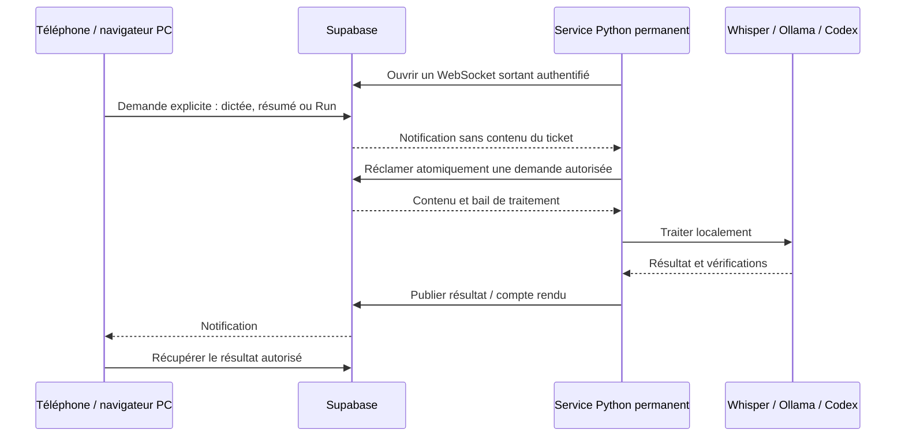

# Maxime : ce que tu dois faire, dans l’ordre

**Commence par l’étape 1 seulement.** Ouvre ensuite une étape à la fois ci-dessous. Les étapes 1 à 4 activent ton site privé ; les étapes 5 et 6 branchent le PC.

**Déjà fait pour toi :** site GitHub Pages, application mobile installable, code, scripts, modèles de dictée/texte installés sur ce PC, service préparé et dépôt Atelier enregistré. **Tu n’as rien à réinstaller et aucun port de ta box à ouvrir.**

**Si une étape échoue : arrête-toi à cette étape et donne-moi son numéro et le message d’erreur. Ne m’envoie pas de mot de passe.**

<details open>
<summary><strong>1 — TOI : créer le projet Supabase</strong></summary>

1. Ouvre [le tableau de bord Supabase](https://supabase.com/dashboard).
2. Crée ton compte ou connecte-toi. Le bouton de connexion avec GitHub peut servir si tu le souhaites.
3. Clique **New project**. Si une organisation est demandée, crée ton organisation personnelle et choisis la formule **Free** ([offre gratuite](https://supabase.com/pricing)).
4. Nomme le projet **atelier**. Choisis une région proche de toi, en Europe.
5. Génère le **Database password** et conserve-le dans ton gestionnaire de mots de passe. Ce mot de passe de base de données ne sera pas celui de connexion à Atelier.
6. Clique **Create new project**, puis attends que son tableau de bord soit prêt.

**C’est bon quand :** tu vois le projet `atelier` et son menu **SQL Editor**. Tu peux t’arrêter ici et me dire « étape 1 terminée » pour qu’on avance ensemble.

</details>

<details>
<summary><strong>2 — TOI : copier les cinq fichiers dans Supabase</strong></summary>

Dans ton projet Supabase, ouvre **SQL Editor → New query**.

Pour **chacun** des liens ci-dessous, dans cet ordre : ouvre le fichier, clique **Raw**, copie tout son contenu, colle-le dans une **nouvelle requête SQL**, puis clique **Run**.

1. [001 — tables de base](../supabase/migrations/001_atelier.sql)
2. [002 — comptes sécurisés et traitements PC](../supabase/migrations/002_connected_workspace.sql)
3. [003 — parents et prérequis](../supabase/migrations/003_ticket_relations.sql)
4. [004 — présence du PC](../supabase/migrations/004_worker_heartbeat.sql)
5. [005 — exécution des tickets](../supabase/migrations/005_ticket_execution.sql)

**Ne modifie rien dans ces cinq fichiers.** Ils s’exécutent une fois chacun. Si tu en as déjà exécuté certains, reprends au suivant ; ne relance pas le début.

**C’est bon quand :** chaque requête affiche une réussite, généralement **Success. No rows returned**. En cas d’erreur, ne passe pas au fichier suivant.

</details>

<details>
<summary><strong>3 — TOI : créer ton compte Atelier et le compte du PC</strong></summary>

Ces deux utilisateurs sont créés **à l’intérieur de ton projet Supabase**. Tu ne crées pas deux nouveaux comptes administrateurs Supabase.

**D’abord, ferme les inscriptions publiques.** Dans **Authentication → Sign In / Providers**, désactive **Allow new users to sign up** et **Allow anonymous sign-ins**, puis enregistre. Garde la connexion e-mail/mot de passe active. [Réglages officiels Supabase](https://supabase.com/docs/guides/auth/general-configuration).

**Crée ton utilisateur :**

1. Va dans **Authentication → Users → Add user → Create new user**.
2. Mets ton adresse e-mail et choisis ton mot de passe **pour Atelier**. Active **Auto Confirm User** si cette option apparaît, puis crée l’utilisateur.
3. Ouvre sa fiche et copie son **User UID / ID** : c’est le long identifiant avec des tirets, pas son e-mail.
4. Ouvre [authorize-owner.sql](../supabase/authorize-owner.sql), copie son contenu dans une nouvelle requête SQL.
5. Remplace uniquement `REPLACE_WITH_YOUR_AUTH_USER_UUID` par cet identifiant, en conservant les apostrophes autour. Clique **Run**.

**Crée ensuite l’utilisateur PC :**

1. Reviens dans **Authentication → Users → Add user → Create new user**.
2. Utilise une autre adresse ou un alias que tu contrôles. Choisis un mot de passe différent ; conserve ces deux valeurs pour l’étape 5. Confirme l’utilisateur comme précédemment.
3. Copie son **User UID / ID**.
4. Ouvre [authorize-worker.sql](../supabase/authorize-worker.sql) et copie son contenu dans une nouvelle requête SQL.
5. Remplace `WORKER_AUTH_UUID` par l’identifiant du **PC**, puis `HUMAN_OWNER_AUTH_UUID` par **ton** identifiant. Conserve les apostrophes. Clique **Run**.

**C’est bon quand :** tu vois deux utilisateurs dans **Users**, et les deux requêtes d’autorisation ont réussi. Le compte PC doit figurer uniquement dans `authorize-worker`, jamais dans `authorize-owner`.

</details>

<details>
<summary><strong>4 — TOI : relier GitHub au projet et ouvrir ton espace privé</strong></summary>

Si tu as créé des notes/tickets dans la démo, ouvre d’abord [Atelier](https://maximeesir.github.io/kanban/) et clique **Exporter mes données**. La démo n’est pas transférée automatiquement.

**Dans Supabase :**

1. Va dans **Authentication → URL Configuration**.
2. Mets **Site URL** à `https://maximeesir.github.io/kanban/`.
3. Ajoute dans **Redirect URLs** : `https://maximeesir.github.io/kanban/?recovery=1`. Enregistre.
4. Clique **Connect** dans ton projet et copie **Project URL** et **Publishable key**. La clé à utiliser commence par `sb_publishable_`. Si nécessaire, retrouve-la dans **Settings → API Keys**. Garde ces deux valeurs pour GitHub et l’étape 5. [Où trouver ces valeurs](https://supabase.com/docs/guides/getting-started/api-keys).

**Dans GitHub :**

1. Ouvre [cette page de variables du dépôt](https://github.com/MaximeESIR/kanban/settings/variables/actions).
2. Dans l’onglet **Variables**, clique **New repository variable**, puis ajoute les deux lignes suivantes, une par une :

   | Name — copie exactement ce nom | Value — colle la valeur correspondante |
   | --- | --- |
   | `VITE_SUPABASE_URL` | Le Project URL copié dans Supabase |
   | `VITE_SUPABASE_PUBLISHABLE_KEY` | La clé `sb_publishable_…` copiée dans Supabase |

3. Ouvre [le workflow de publication](https://github.com/MaximeESIR/kanban/actions/workflows/deploy.yml).
4. Clique **Run workflow**, choisis la branche **main**, puis confirme **Run workflow**.
5. Attends que **verify**, **build** et **deploy** soient verts.

**Aucun fichier de code à modifier :** ces deux variables activent automatiquement la vraie connexion. GitHub Pages est déjà configuré.

**Dans Atelier :**

1. Ouvre [l’application](https://maximeesir.github.io/kanban/) et connecte-toi avec **ton utilisateur de l’étape 3**, pas avec `k@k.k`.
2. Clique **Configurer la double authentification**. Scanne le QR code avec ton application d’authentification sur téléphone.
3. Saisis son **code à six chiffres**, puis clique **Vérifier**. Conserve une sauvegarde de cette application d’authentification.

**C’est bon quand :** tu vois tes projets après cette connexion. **Tu peux t’arrêter là pour utiliser le site privé** ; la partie PC vient ensuite. Si l’ancienne démo apparaît encore, ferme tous les onglets et la PWA Atelier, puis rouvre le site pour activer la mise à jour.

</details>

<details>
<summary><strong>5 — TOI : remplir le fichier privé du PC</strong></summary>

Sur **ton PC Ubuntu**, ouvre un terminal avec **Ctrl + Alt + T**, puis lance :

```bash
nano /home/mblaret/.config/atelier/worker.env
```

Ce fichier existe déjà. Remplis uniquement les quatre lignes suivantes avec les valeurs des étapes précédentes, après le signe `=` :

| Ligne | Ce que tu dois y mettre |
| --- | --- |
| `ATELIER_SUPABASE_URL=` | Le même Project URL qu’à l’étape 4 |
| `ATELIER_PUBLISHABLE_KEY=` | La même clé `sb_publishable_…` qu’à l’étape 4 |
| `ATELIER_WORKER_EMAIL=` | L’e-mail de l’utilisateur **PC** créé à l’étape 3 |
| `ATELIER_WORKER_PASSWORD=` | Le mot de passe de cet utilisateur **PC** |

Ne mets ni ton compte personnel Atelier, ni le mot de passe de la base de données. Pour le mot de passe PC, une valeur aléatoire de 32 lettres/chiffres évite les caractères nécessitant un échappement dans ce fichier.

**Ne touche pas aux autres lignes : les modèles sont déjà configurés.**

Enregistre avec **Ctrl + O**, puis **Entrée** ; quitte avec **Ctrl + X**. Garde ce fichier sur ton PC, sans le copier dans GitHub ni dans la conversation.

**C’est bon quand :** les quatre valeurs sont remplies et le fichier est enregistré.

</details>

<details>
<summary><strong>6 — TOI : autoriser l’isolation Ubuntu, puis démarrer le PC</strong></summary>

**Cette étape demande ton mot de passe administrateur Ubuntu.** Il sert à autoriser le mécanisme de protection de Codex. Je n’ai pas pu réaliser cette action avec les droits disponibles.

Dans le terminal du PC, exécute ces commandes **une par une**. Quand `sudo` demande ton mot de passe, rien ne s’affiche pendant la saisie : c’est normal.

```bash
sudo apt install apparmor-profiles apparmor-utils
ls /usr/share/apparmor/extra-profiles/bwrap-userns-restrict
```

**Si `ls` dit que le fichier n’existe pas, arrête-toi et donne-moi ce message.** Sinon, continue :

```bash
sudo install -m 0644 /usr/share/apparmor/extra-profiles/bwrap-userns-restrict /etc/apparmor.d/bwrap-userns-restrict
sudo apparmor_parser -r /etc/apparmor.d/bwrap-userns-restrict
cd /home/mblaret/Documents/kanban
python3 worker/ticket_executor.py doctor
```

**Si le diagnostic dit « Isolation Codex indisponible », arrête-toi et transmets-moi ce message.** On ne désactive pas cette protection pour faire fonctionner Run. Cette correction ciblée est décrite dans la [documentation du sandbox Codex](https://learn.chatgpt.com/docs/sandboxing).

**Si le diagnostic dit « Isolation vérifiée », démarre le service :**

```bash
python3 worker/install_service.py
systemctl --user enable --now atelier-worker.service
systemctl --user status atelier-worker.service --no-pager
```

La dernière commande doit afficher **active (running)**. Attends quelques secondes, puis :

1. Dans Atelier, ouvre une note → **Assistant PC** : le PC doit apparaître connecté. Fais une courte dictée pour vérifier le retour du texte.
2. Dans un projet, ouvre **Associer un dépôt sur le PC**. Sélectionne **Atelier** ; vérifie le chemin `/home/mblaret/Documents/kanban`.
3. Si tu veux travailler dans un **autre dépôt**, donne-moi son chemin exact avant de lancer ses tickets : il faudra l’enregistrer sur le PC.
4. Le premier test réel de **Run** reste à vérifier ensemble sur un ticket de test précis. Ne lance pas un ticket quelconque uniquement pour essayer : Run autorise réellement Codex à modifier sa copie de travail.

**C’est bon quand :** le service tourne, le PC est connecté et une dictée revient dans l’application. La validation d’une vraie tâche Codex est la dernière vérification à faire ensemble.

</details>

---

**Mon travail après ton branchement :** vérifier la connexion réelle, la dictée depuis ton téléphone et un ticket Codex de test, puis corriger les problèmes constatés. Tu n’as pas à réécrire les scripts ou à comprendre leur architecture.

<details>
<summary><strong>Documentation technique — facultative pour réaliser les étapes ci-dessus</strong></summary>

## État vérifié au 1er novembre 2026

| Partie | État réel |
| --- | --- |
| Site GitHub Pages / PWA installable sur téléphone | Interface utilisable en démo ; projets, notes riches, parents, prérequis, tri et brouillons testés. |
| Compte privé, TOTP, synchronisation | Code et migrations prêts, règles testées avec PostgreSQL local ; projet Supabase réel à créer. |
| Dictée locale | faster-whisper small installé, transcription française réellement exécutée sur le PC. |
| Résumé, réécriture, recherche | Ollama + Qwen3.5 4B installés, trois inférences réelles réussies sur le PC. |
| Run, suivi et validation humaine | Interface, file SQL, scripts, agent et tests disponibles. Parcours navigateur testé sur serveur simulé ; worktree, processus et rapport testés avec exécuteur simulé. |
| Exécution réelle Codex | CLI déjà connecté avec ChatGPT, mais **sandbox Ubuntu bloqué**. Run refuse de démarrer tant que le contrôle ne passe pas. |
| Téléphone → Supabase hébergé → PC → téléphone | Pas encore vérifié : absence du projet et des comptes Supabase. |

Les identifiants publics `k@k.k` / `k` restent une démo **locale à chaque navigateur**. Ils ne protègent pas un compte privé et n’activent aucun traitement sur le PC. Pas de pourcentage artificiel de « fonctionnement global » : distinguer l’interface, les moteurs réellement testés et la connexion encore à activer.

## 1. Votre compte Supabase et GitHub

1. Créer un compte Supabase et un projet dédié. Dans **SQL Editor**, exécuter une fois chaque migration, dans l’ordre :
   - `001_atelier.sql`
   - `002_connected_workspace.sql`
   - `003_ticket_relations.sql`
   - `004_worker_heartbeat.sql`
   - `005_ticket_execution.sql`

   Si certaines ont déjà été appliquées, ne lancer que les suivantes. L’application exige la version 5. La migration 005 ajoute `atelier_events` à la publication `supabase_realtime` lorsqu’elle existe ; vérifier que cette table est activée dans les réglages Realtime. **Seules des notifications sans contenu privé sont répliquées** ; tickets, audio et résultats sont récupérés par les accès autorisés.

2. Désactiver inscriptions publiques et connexion anonyme. Créer votre compte humain e-mail/mot de passe, confirmer son adresse, puis exécuter `supabase/authorize-owner.sql` avec son UUID.
3. Créer un **second compte Auth pour le PC**, avec un mot de passe aléatoire long et unique. Exécuter `supabase/authorize-worker.sql` avec les UUID du propriétaire et du PC. **Ne jamais ajouter le compte PC aux propriétaires.** Aucun rôle administrateur ni clé `service_role` sur le PC ou dans le navigateur.
4. GitHub et le dépôt existent déjà. Dans [Actions → Variables](https://github.com/MaximeESIR/kanban/settings/variables/actions), renseigner `VITE_SUPABASE_URL` et `VITE_SUPABASE_PUBLISHABLE_KEY` (`sb_publishable_…`). Les deux variables désactivent automatiquement la démo : aucune modification du workflow n’est nécessaire pour activer Supabase. Relancer [Publish Atelier](https://github.com/MaximeESIR/kanban/actions/workflows/deploy.yml). Pages reste sur **Source : GitHub Actions**, HTTPS activé.
5. Supabase Auth → URL Configuration : Site URL `https://maximeesir.github.io/kanban/`, Redirect URL de récupération `https://maximeesir.github.io/kanban/?recovery=1`. Configurer et tester les e-mails de récupération. Protéger aussi les comptes administrateurs GitHub/Supabase par 2FA.
6. Se connecter à Atelier et associer une application TOTP. Les règles serveur exigent le second facteur, même en appelant directement l’API. Sauvegarder votre application TOTP ; en cas de perte, intervenir via l’administration après vérification d’identité, sans désactiver la RLS.

**Avant activation**, exporter les données de démo. Elles ne sont pas importées automatiquement dans Supabase ; l’import n’est pas implémenté. La clé publique identifie l’application ; session, TOTP et RLS autorisent l’accès. Sources : [clés Supabase](https://supabase.com/docs/guides/getting-started/api-keys), [TOTP](https://supabase.com/docs/guides/auth/auth-mfa/totp).

## 2. Modèles déjà installés sur ce PC

Installation sous le compte utilisateur, sans toucher aux autres modèles ni aux calculs GPU en cours :

| Composant | Configuration |
| --- | --- |
| Ollama | 0.40.13, archive officielle vérifiée par SHA-256 ; `~/.local/bin/ollama` |
| Service Ollama | `atelier-ollama.service`, activé au démarrage de la session utilisateur |
| Texte | `qwen3.5:4b`, 4,2 milliards de paramètres, Q4_K_M, environ 3,3 Go |
| Dictée | `Systran/faster-whisper-small`, révision `536b0662742c02347bc0e980a01041f333bce120`, environ 464 Mo |
| Python | `worker/.venv`, dépendances fixées dans `worker/requirements.txt` |
| Modèles | `~/.local/share/atelier/models/` |

Ollama écoute uniquement sur **127.0.0.1:11434**, `OLLAMA_NO_CLOUD=1`. CPU choisi pour préserver le GPU déjà occupé. Whisper utilise CPU/int8. Le worker charge uniquement les modèles déjà téléchargés ; une demande web ne déclenche aucun téléchargement.

Mesures ponctuelles, sur Intel i7-14700HX, sans prétendre garantir une latence :

| Essai réel | Résultat |
| --- | --- |
| Dictée française synthétique, 7,5 s d’audio | Chargement 0,66 s + transcription 2,84 s. Erreurs sur « Jetson » et « inférence ». |
| Même audio, vocabulaire technique personnalisé, via le worker | Environ 5,1 s processus/imports compris. « Jetson » correctement reconnu ; « inférence » reste mal reconnu. |
| Premier résumé de trois étapes Jetson | 20,06 s, chargement du modèle inclus ; contenu fidèle. |
| Réécriture, modèle chargé | 0,60 s ; correction d’une phrase. |
| Recherche Jetson parmi deux documents | 4,65 s ; bon identifiant retrouvé, sans sélectionner l’autre document. |

Ces essais ne remplacent pas un enregistrement réel de votre voix sur téléphone ni un benchmark de longues notes. `ATELIER_DICTATION_VOCABULARY` aide les termes techniques sans garantir leur reconnaissance. `ATELIER_THINK=false` est configuré pour Qwen3.5, contexte 8192 tokens. Une note très longue peut dépasser ce contexte : la réduire ou ajuster le contexte à la mémoire disponible. Le premier chargement est plus lent ; Ollama décharge le modèle après deux minutes d’inactivité.

Sur un autre PC Linux : Python 3.11+, `python3 -m venv worker/.venv`, `worker/.venv/bin/pip install -r worker/requirements.txt`, installer [Ollama](https://docs.ollama.com/linux), télécharger le modèle, puis télécharger un modèle compatible [faster-whisper](https://github.com/SYSTRAN/faster-whisper). PyAV est fixé à 16.1.0 : la version 19 testée était incompatible avec faster-whisper 1.2.1.

## 3. Corriger l’isolation Codex sur ce PC

Codex CLI 0.166.0 est déjà connecté avec le compte ChatGPT. **Codex local désigne son exécution dans le dépôt sur votre PC ; son modèle utilise les serveurs OpenAI et votre abonnement.** Ce n’est pas le modèle Ollama local. Aucune clé API IA n’est nécessaire, mais une connexion Internet et des droits d’utilisation Codex restent nécessaires.

Diagnostic :

```bash
python3 worker/ticket_executor.py doctor
```

Actuellement, Ubuntu 24.04 refuse la création du sandbox (`bwrap`, user namespaces, `Operation not permitted`). Le contrôle échoue donc avant toute inférence ou modification d’un dépôt. Les tests simulés ne prouvent pas une exécution réelle Codex.

La [documentation officielle Ubuntu/Codex](https://learn.chatgpt.com/docs/sandboxing) propose un profil AppArmor ciblé. À faire par un administrateur sur ce PC, après vérification du profil fourni par le paquet :

```bash
sudo apt install apparmor-profiles apparmor-utils
ls /usr/share/apparmor/extra-profiles/bwrap-userns-restrict
sudo install -m 0644 /usr/share/apparmor/extra-profiles/bwrap-userns-restrict /etc/apparmor.d/bwrap-userns-restrict
sudo apparmor_parser -r /etc/apparmor.d/bwrap-userns-restrict
python3 worker/ticket_executor.py doctor
```

Si le fichier n’est pas fourni ou le contrôle échoue encore, conserver Run désactivé et examiner le diagnostic. **Ne pas désactiver globalement AppArmor ou les restrictions système, ne pas passer Codex en accès intégral.** Les droits administrateur non disponibles dans cette session empêchent d’appliquer et de vérifier cette correction ici.

Le profil Codex limite les lectures et écritures, interdit les identifiants Atelier/Codex/SSH et le réseau des commandes, protège les métadonnées Git, désactive connecteurs, hooks et sous-agents. `--sandbox workspace-write` n’est pas ajouté : il écraserait les restrictions de lecture du profil nommé. Le contrôle exécute réellement une commande sans modèle et vérifie accès autorisé, refus d’accès privé, protection Git et réseau, à l’aide d’un témoin temporaire accessible seulement sur le loopback du PC. Sources : [permissions Codex](https://learn.chatgpt.com/docs/permissions), [mode non interactif](https://learn.chatgpt.com/docs/non-interactive-mode).

## 4. Un projet = un dépôt autorisé

Sur le PC, enregistrer explicitement **la racine Git** :

```bash
python3 worker/ticket_executor.py add /chemin/absolu/du/depot --label "Mon projet"
python3 worker/ticket_executor.py list
```

Le dépôt Atelier courant est déjà enregistré sur ce PC. Le registre privé est `~/.config/atelier/repositories.json` (permissions 600). Pour retirer un dépôt : `python3 worker/ticket_executor.py remove UUID_DU_DEPOT`. Le service actualise le registre toutes les 30 secondes.

Dans le projet sur téléphone ou ordinateur, ouvrir **Associer un dépôt sur le PC**, sélectionner le nom et **vérifier le chemin affiché**. Ce choix fixe le dépôt du projet. Plusieurs projets peuvent être associés à des dépôts différents ; tous utilisent la même file et **une seule session Codex à la fois**. Un nouveau chemin saisi uniquement dans un ticket n’accorde aucun droit au PC : il doit d’abord être enregistré localement.

Après ajout d’un dépôt, régénérer le service ci-dessous : systemd doit permettre au script Git d’écrire les métadonnées de ce dépôt. Les commandes Codex restent soumises à leur profil plus restrictif.

## 5. Configurer et démarrer le service

Sur ce PC, le service utilisateur et le fichier privé ont été préparés mais **le service Atelier n’est pas démarré**, faute de Supabase. Ollama, lui, fonctionne déjà.

```bash
python3 worker/install_service.py
```

Ce script crée le fichier privé s’il n’existe pas et génère l’unité systemd à partir des chemins autorisés. Il ne remplace pas vos identifiants existants et ne lance pas un service non configuré.

Renseigner dans `~/.config/atelier/worker.env` :

- `ATELIER_SUPABASE_URL`
- `ATELIER_PUBLISHABLE_KEY` (publique, jamais administrateur)
- `ATELIER_WORKER_EMAIL` (compte PC séparé)
- `ATELIER_WORKER_PASSWORD`

Les chemins des modèles et leurs réglages sont déjà présents. Conserver `chmod 600 ~/.config/atelier/worker.env`. Les valeurs doivent respecter la syntaxe `EnvironmentFile` de systemd ; ne pas publier ce fichier.

Après configuration et diagnostic :

```bash
systemctl --user enable --now atelier-worker.service
systemctl --user status atelier-worker.service
journalctl --user -u atelier-worker.service -n 50
```

Après correction du sandbox, redémarrer le service pour refaire son contrôle initial. Pour arrêter : `systemctl --user stop atelier-worker.service`. Désactiver les démarrages futurs : `systemctl --user disable atelier-worker.service` (et `atelier-ollama.service` si souhaité).

Le service vise **Linux** et utilise `fcntl`, les groupes de processus, le sandbox Codex et systemd. Aucun support Windows/macOS n’est revendiqué pour cet exécuteur. Le PC doit rester éveillé, connecté et dans une session où le service utilisateur fonctionne. Verrouiller l’écran n’arrête pas le service ; mise en veille ou fermeture de session peuvent l’arrêter.

## 6. Comment le PC reçoit les demandes



**Oui, un petit script tourne en continu. Non, il n’y a aucun port entrant Internet à ouvrir**, ni redirection sur la box. Le PC établit lui-même le WebSocket TLS vers Supabase et utilise HTTPS pour les RPC. Ollama dispose seulement d’un port local sur le PC. On ne lit pas la page HTML et aucun LLM ne tourne pour surveiller les tickets.

Les demandes et résultats sont persistants dans Supabase ; les notifications réveillent le service. Après abonnement et reconnexion, il rattrape la file. Après une fin de traitement, il vérifie s’il reste une demande. Les heartbeats annoncent la présence (environ 10 s), le navigateur vérifie cette présence toutes les 15 s, et la file hors ligne est entretenue toutes les 30 s. Ce ne sont pas des appels de modèle ni du scraping de page. L’application reçoit les changements sans reload ; un navigateur suspendu rattrape à la reprise.

### Dictée et notes

Dans une note ou un ticket, ouvrir **Assistant PC**, toucher **Dicter**, parler, puis arrêter. **L’audio est envoyé à l’arrêt**, pas mot à mot. Le résultat apparaît comme proposition ; insertion explicite et annulation disponibles. Réécriture et résumé passent par Ollama ; recherche sémantique légère sur les documents fournis. Sans PC, recherche textuelle et édition restent disponibles ; aucun fournisseur cloud ne prend le relais implicitement.

### Tickets Run

1. Enregistrer le ticket, vérifier ses prérequis et son dépôt, cliquer **Run**.
2. Le ticket reste en attente tant que la session précédente occupe le PC. Aucun changement de dépôt ou double démarrage silencieux.
3. À la prise en charge : **In progress**. Le service crée `atelier/UUID` et un worktree séparé depuis le **HEAD commité** du dépôt. Les modifications non commitées de votre copie habituelle ne sont pas incluses et restent intactes.
4. Le rôle `atelier-ticket` lit le code, planifie, réalise, teste et produit un compte rendu court. Les scripts transmettent l’état et le résultat ; Codex ne se connecte pas à Supabase ou GitHub pour gérer le ticket.
5. Le ticket reste **In progress — À valider**. Lire tests et limites, examiner le code local, puis **Valider et passer à Done** ou écarter le résultat. **Cette validation ne fusionne pas le code.** Aucun push/merge/déploiement automatique.

Les fichiers se trouvent sous `~/.local/share/atelier/executions/UUID/` : `worktree/`, `events.jsonl`, `receipt.json`, `report.json`, `delivery.json`. Journaux privés et modifications sont conservés après échec/annulation ; les nettoyer manuellement après revue, avec `git worktree remove` pour un worktree terminé et la suppression volontaire de sa branche si approprié. Les scripts ne suppriment pas automatiquement votre travail.

L’agent est défini dans `.codex/agents/atelier-ticket.toml`. Le service charge son rôle dans **la session unique** ; il ne lance pas une équipe. On peut aussi demander à Codex d’utiliser ce rôle lors d’une session manuelle dans le projet, mais la gestion de file/statut appartient au service.

## Limites et garanties précises

- AAL2/TOTP pour les humains ; compte PC distinct, accès par RPC limité aux opérations et au propriétaire associés. Les chemins et commandes du navigateur ne deviennent pas des commandes shell.
- Run nécessite PC disponible et dépôt autorisé. Jusqu’à 20 exécutions en attente/en cours et 60 lancements/heure. Une seule active par ticket et une seule session Codex par PC. Annulation/retrait d’accès vérifiés pendant l’exécution ; bail expiré ou résultat tardif refusé. Pas de relance automatique d’une session incertaine.
- Une perte de contact prolongée arrête la session Codex ; la copie de travail reste disponible. Un processus peut avoir déjà écrit des fichiers avant l’annulation. L’arrêt vise tout son groupe de processus, y compris les tests lancés.
- Le dépôt autorisé et ses métadonnées Git sont lisibles : ne pas conserver de mots de passe dans `.git/config` ni dans l’historique. Les exclusions des fichiers personnels ne peuvent pas effacer un secret déjà commité.
- Le réseau des commandes Codex est fermé. Préparer les dépendances avant la tâche ou les tests peuvent rester bloqués. Le rapport doit le dire ; « À valider » ne signifie pas que toutes les vérifications ont réussi.
- Texte/audio : cinq demandes actives maximum, 60/heure ; audio 90 s et 4 Mo ; traitement limité à quatre minutes. Whisper est chargé dans un processus isolé par dictée. Une dictée peut fonctionner pendant une session Codex, au prix de ressources partagées.
- L’audio, les demandes et comptes rendus transitent par Supabase. TLS protège le transport ; **pas de chiffrement de bout en bout**. Les anciens résultats texte/audio sont purgés après sept jours lors de la consommation de la file ; les rapports de développement sont conservés avec le ticket.
- Recherche : 200 documents et 150 000 caractères JSON au maximum, contexte effectivement disponible dépendant du modèle. Pas d’index vectoriel persistant, pas de garantie contre les erreurs du modèle. Vérifier les sources proposées.
- Les données hors ligne et brouillons sont dans le navigateur sans chiffrement applicatif. Verrouiller/chiffrer les appareils ; la déconnexion efface les copies privées après synchronisation. Un administrateur ne peut pas effacer une copie déjà téléchargée sur un appareil distant.
- Tous les sites `MaximeESIR.github.io/...` partagent une origine navigateur : un autre site compromis sur cette origine pourrait lire les stockages. Pour isoler fortement Atelier, utiliser un sous-domaine dédié et l’ajouter dans Pages et Supabase Auth.
- Révocation du PC dans SQL : `update private.workers set enabled=false where user_id='UUID';`. Changer aussi le mot de passe s’il a été compromis.

## Vérification réelle après branchement

1. Mot de passe seul : données interdites ; après TOTP : accès. Compte PC : aucune lecture directe des notes/tickets.
2. Note modifiée sur téléphone → visible sur PC sans reload, puis inversement. Tester hors ligne/reconnexion et conflit entre appareils.
3. Arrêter le service → indisponibilité affichée ; redémarrer → disponibilité. Couper/reprendre le réseau et vérifier le rattrapage.
4. Dicter votre voix pendant 15 s, mesurer arrêt → résultat, vérifier les termes techniques. Tester réécriture, annulation et modification pendant traitement.
5. Sur un dépôt de test, Run un petit ticket avec tests connus : statut, branche, fichiers, compte rendu, aucun Done automatique. Valider explicitement.
6. Lancer deux tickets dans deux projets : constater une seule session Codex. Annuler l’un, vérifier arrêt et conservation du travail. Retirer le worker et vérifier refus des actions suivantes.
7. Vérifier que l’isolation refuse les fichiers personnels et le réseau, sans tenter de contourner le sandbox. Ne confier des dépôts sensibles qu’après ces vérifications réelles.

</details>
