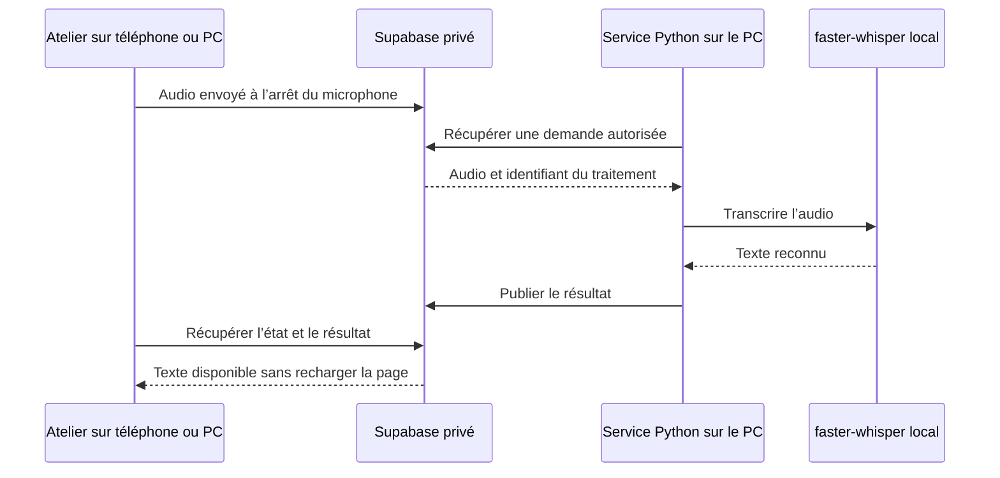

# Brancher Atelier V1.1 — état du projet et mise en service

## Ce qui est fonctionnel, et ce qui attend votre configuration

| Partie | État |
| --- | --- |
| Site GitHub Pages et application installable | Déployés ; utilisables en démo sur PC et téléphone. |
| Projets, tickets, notes, parents, prérequis multiples, tri global | Implémentés et testés dans le navigateur. |
| Brouillons de tickets | Conservés localement à chaque saisie ; enregistrement à la fermeture/en arrière-plan, restauration après interruption et copie en cas de conflit. |
| Compte privé, TOTP et synchronisation entre appareils | Code et migrations prêts, règles vérifiées dans PostgreSQL local ; projet Supabase réel à créer/configurer. |
| Dictée, résumé, réécriture, recherche sur le PC | Service Python fourni et protocole testé avec moteurs simulés ; moteurs et identifiants réels à installer/configurer. |
| Agent qui développe les tickets et les passe automatiquement à Done | Non implémenté. C’est une future intégration distincte. |

Il n’y a pas de pourcentage fiable de « fonctionnement global » : l’interface est utilisable, mais le service connecté n’est pas en production tant que les étapes ci-dessous ne sont pas faites et testées sur vos appareils. Les identifiants publics `k@k.k` / `k` restent une démo locale à chaque navigateur.

## Ce qui reste à faire côté propriétaire

1. Créer votre compte Supabase et un projet dédié, dans la région choisie. Dans **SQL Editor**, exécuter les fichiers de `supabase/migrations/` dans cet ordre : `001_atelier.sql`, `002_connected_workspace.sql`, `003_ticket_relations.sql`, `004_worker_heartbeat.sql`, une fois chacun. Si 001/002 ont déjà été appliquées, exécuter seulement 003/004. L’application refuse une base plus ancienne au lieu d’ignorer silencieusement les nouveaux liens.
2. Désactiver les inscriptions publiques et l’authentification anonyme. Créer votre compte humain e-mail/mot de passe depuis Auth, confirmer son adresse, puis exécuter `supabase/authorize-owner.sql` avec son UUID.
3. Créer un SECOND compte Auth pour le PC avec un mot de passe aléatoire long et unique. Exécuter `supabase/authorize-worker.sql` avec les deux UUID. **Ne jamais ajouter le compte PC à la liste des propriétaires.** Les identifiants PC doivent rester hors du navigateur et du dépôt.
4. Le compte GitHub et le dépôt existent déjà : aucun nouveau compte GitHub n’est nécessaire. Dans [Settings → Secrets and variables → Actions → Variables](https://github.com/MaximeESIR/kanban/settings/variables/actions), renseigner `VITE_SUPABASE_URL` (URL du projet) et `VITE_SUPABASE_PUBLISHABLE_KEY` (clé publique `sb_publishable_…`, jamais `service_role` ni `sb_secret_…`). Dans `.github/workflows/deploy.yml`, mettre `VITE_PUBLIC_DEMO` à `false` dans le job **build** ; garder la démo du job **verify** pour les tests. Les deux variables Supabase désactivent déjà la démo automatiquement. Relancer [Publish Atelier to GitHub Pages](https://github.com/MaximeESIR/kanban/actions/workflows/deploy.yml) et attendre le succès des trois jobs. Pages doit rester sur **Source : GitHub Actions**, avec HTTPS activé.
5. Dans **Supabase Auth → URL Configuration**, mettre `https://maximeesir.github.io/kanban/` comme Site URL et `https://maximeesir.github.io/kanban/?recovery=1` dans Redirect URLs. Configurer et tester les e-mails de récupération si utilisés. Protéger aussi les comptes administrateurs GitHub/Supabase par 2FA.
6. Se connecter à Atelier : l’écran impose l’association d’une application TOTP et la vérification d’un code avant d’ouvrir l’espace. Conserver une sauvegarde de l’application TOTP. Pour une perte de facteur, intervenir depuis l’administration Supabase après vérification de l’identité ; ne pas désactiver la RLS.

La migration 002 rend la double authentification obligatoire. Les anciennes sessions non vérifiées ne peuvent plus lire les tables même en appelant directement l’API.

Avant d’activer Supabase, exporter les données de démonstration avec le bouton de sauvegarde : elles ne sont pas transférées automatiquement et l’import n’est pas encore implémenté. La clé publique Supabase sert à identifier l’application ; l’autorisation repose sur la session, le TOTP et la RLS. [Documentation des clés Supabase](https://supabase.com/docs/guides/getting-started/api-keys), [TOTP](https://supabase.com/docs/guides/auth/auth-mfa/totp).

## Moteurs sur le PC

Aucun compte Groq, OpenAI ou autre fournisseur IA n’est nécessaire. Un modèle local doit néanmoins être installé :

- Installer Ollama depuis sa source officielle, télécharger un modèle adapté à la RAM/VRAM du PC, puis vérifier qu’il répond localement. Utiliser `ollama list` pour récupérer son nom exact (avec son tag).
- Garder Ollama sur `127.0.0.1:11434`. Activer `OLLAMA_NO_CLOUD=1` pour rester exclusivement local. Ne pas exposer son port sur Internet.
- Installer Python 3.11 ou supérieur. Depuis le dépôt : `python3 -m venv worker/.venv`, puis `worker/.venv/bin/pip install faster-whisper` si la dictée est souhaitée. Le worker texte n’a aucune dépendance Python externe.
- Télécharger explicitement un modèle au format CTranslate2 compatible faster-whisper depuis une source de confiance. Donner son chemin absolu dans `ATELIER_WHISPER_MODEL`. Le worker utilise `local_files_only=True` : une demande web ne peut pas déclencher de téléchargement.
- Les variables `ATELIER_WHISPER_DEVICE` et `ATELIER_WHISPER_COMPUTE` permettent CPU/int8 par défaut ou une configuration GPU compatible. Tester une courte dictée avant un usage prolongé.

Ollama sert au texte ; faster-whisper sert à l’audio. Installer seulement un LLM Ollama ne suffit donc pas pour la dictée. Les sources à suivre sont [Ollama](https://docs.ollama.com/) et [faster-whisper](https://github.com/SYSTRAN/faster-whisper). Le script utilise l’API locale [Ollama Chat](https://docs.ollama.com/api/chat).

## Configuration privée du service

Créer `~/.config/atelier/worker.env` à partir de `worker/.env.example`, remplir les valeurs, et limiter les permissions du fichier à votre utilisateur (`chmod 600`). Les valeurs contenant des caractères spéciaux doivent être correctement citées selon le mécanisme de chargement choisi.

Pour un lancement manuel sous Bash, utiliser un fichier de confiance au format shell :

```bash
set -a
source ~/.config/atelier/worker.env
set +a
worker/.venv/bin/python worker/atelier_worker.py
```

Pour Linux/systemd, adapter les chemins de `worker/atelier-worker.service`, puis copier le fichier dans `~/.config/systemd/user/` et lancer :

```bash
systemctl --user daemon-reload
systemctl --user enable --now atelier-worker.service
journalctl --user -u atelier-worker.service
```

Sur Windows/macOS, le même script Python peut être lancé au démarrage avec le planificateur de l’OS. Aucun service permanent n’est installé automatiquement par le dépôt.

Garder le PC connecté à Internet, éveillé et le service actif. Un PC allumé mais en veille, ou sans le service lancé, ne peut pas traiter les demandes. Le service systemd utilisateur démarre avec la session de cet utilisateur ; le verrouillage de l’écran ne l’arrête pas, une fermeture de session peut l’arrêter selon la configuration système.

Le PC ne reçoit aucune connexion entrante : il interroge Supabase en HTTPS. Le navigateur interroge la présence et les résultats toutes les trois secondes. Un PC peut être visible sans offrir la dictée si Whisper n’est pas prêt. Les boutons correspondants restent alors désactivés.

## Parcours concret d’une dictée depuis le téléphone



Le script **`worker/atelier_worker.py` existe déjà** : il récupère les demandes dans la file Supabase. Il n’essaie pas de lire ou piloter la page HTML. Le téléphone peut être sur un autre réseau que le PC. Depuis une note ou un ticket, ouvrir « Assistant PC », vérifier la disponibilité, toucher « Dicter », parler, puis arrêter. Le texte apparaît en aperçu et peut être inséré avec le bouton d’application ; la modification est annulable. Une réécriture ou un résumé suit le même trajet en utilisant Ollama.

La dictée est envoyée **à l’arrêt de l’enregistrement** : ce n’est pas une transcription mot à mot en continu. Le PC vérifie les nouvelles demandes toutes les **2 secondes** par défaut (`ATELIER_POLL_SECONDS`, de 1 à 30) ; le navigateur récupère les résultats toutes les **3 secondes** et vérifie aussi immédiatement après l’envoi ou au retour dans la fenêtre. Ces intervalles visent quelques secondes de transport, auxquelles s’ajoutent le réseau, une éventuelle file d’attente et le calcul. Ils ne garantissent pas un délai maximal, notamment lorsque le navigateur est en arrière-plan.

Le temps de calcul n’a pas encore été mesuré sur votre PC. Il dépend du CPU/GPU, du modèle, de la durée audio et du chargement du moteur. Le modèle Whisper est actuellement chargé dans un processus isolé pour chaque dictée ; si ce chargement devient le principal délai, un moteur conservé en mémoire sera l’optimisation suivante, après mesure. Une seule demande est traitée à la fois par service PC.

Sans PC disponible, les projets et les notes restent utilisables et synchronisables via Supabase. La recherche textuelle reste disponible ; les fonctions IA locales sont indisponibles. Aucun fournisseur cloud n’est utilisé implicitement.

## Protocole et limites

- Opérations autorisées : `summarize`, `rewrite`, `transcribe`, `search`. Toute autre opération est refusée. Aucun accès terminal, Git, Codex ou Vibe n’est activé.
- Présence : moins de 45 secondes ; maximum cinq demandes en attente et 60 par heure et par propriétaire.
- Dictée : 90 secondes et 4 Mo maximum. L’audio transite temporairement par Supabase ; il ne reste pas exclusivement sur les appareils. TLS protège le transport, ce n’est pas du chiffrement de bout en bout.
- Un traitement est limité à quatre minutes côté PC et son bail à cinq minutes côté serveur. Il n’est pas relancé automatiquement après un incident. Une annulation empêche l’utilisation du résultat ; le calcul local déjà lancé peut terminer avant d’être abandonné.
- Recherche : 200 documents maximum, 150 000 caractères JSON de contexte ; documents longs limités à 12 000 caractères par l’interface. Le modèle classe les sources fournies, sans index vectoriel persistant. Au-delà, prévoir une indexation locale par embeddings ; aucun fallback cloud implicite.
- Les contenus des résultats et des documents ne sont jamais exécutés. Les identifiants de sources retournés sont filtrés, mais les justifications restent celles d’un modèle et doivent être vérifiées.
- Retrait d’accès au PC : `update private.workers set enabled=false where user_id='UUID';`. Les nouvelles prises de travaux et livraisons sont refusées immédiatement. Changer aussi son mot de passe si compromis.
- Les données hors ligne sont stockées dans le navigateur de chaque appareil, sans chiffrement applicatif. Protéger l’appareil par verrouillage/chiffrement système. La déconnexion efface le cache privé après synchronisation ; un administrateur ne peut pas effacer à distance une copie déjà téléchargée.
- Les brouillons de tickets sont locaux à l’appareil et séparés par compte/édition. Un brouillon n’apparaît sur l’autre appareil qu’après enregistrement et synchronisation. L’export JSON général inclut ces brouillons ; la déconnexion les efface. « Annuler les modifications » abandonne les changements depuis le dernier enregistrement, y compris si un enregistrement a déjà eu lieu en arrière-plan.

## Origine web et protection des appareils

Tous les sites `MaximeESIR.github.io/...` partagent la même origine navigateur. Un script compromis sur un autre site du même domaine pourrait accéder aux stockages et à la session. Pour une isolation forte, réserver un sous-domaine dédié à Atelier et le configurer dans GitHub Pages et Supabase Auth. Un dépôt privé ne corrige pas ce problème d’origine. Ne pas héberger de scripts non fiables sur la même origine.

## Validation réelle avant utilisation

1. Connexion humaine avec mot de passe seul : données interdites ; avec TOTP : données accessibles.
2. Compte PC : appels directs aux tables privés refusés, RPC worker autorisées uniquement après association.
3. Modifier une note sur téléphone et vérifier son apparition sur PC sans rechargement ; inverser les appareils.
4. Modifier hors ligne, rouvrir l’application, reconnecter ; vérifier les données et le compteur de synchronisation.
5. Modifier simultanément la même note sur deux appareils : la version distante doit rester intacte et la copie locale être présente dans « Sauvegarde complète ». Le bouton « Récupérer les conflits en notes » crée des copies distinctes pour les comparer et les fusionner.
6. Éteindre le service PC : boutons IA désactivés après expiration de présence. Le relancer : disponibilité visible.
7. Tester résumé, annulation, modification pendant traitement et dictée ; vérifier les résultats dans l’autre appareil.
8. Pour une dictée de 15 secondes, mesurer le temps entre l’arrêt et l’apparition du résultat, puis refaire l’essai. Noter modèle, CPU/GPU, durée audio et délai obtenu avant de fixer un objectif de rapidité.
9. Créer un parent, deux prérequis et un ticket dépendant des deux ; vérifier compteurs, changement « Bloqué → Prêt », suppression d’un lien et restauration d’un brouillon après fermeture du navigateur.

## Future intégration des agents de développement

Prévoir un service séparé et une autorisation explicite par projet/repository pour les travaux Codex/Vibe. Il consommera des demandes structurées avec identifiant de ticket, révision attendue, dépôt autorisé et branche de travail. Avancement, traces et liens de PR reviendront comme résultats. Aucun nom de commande ni chemin arbitraire soumis par le navigateur ne devra devenir une commande shell. La file présente peut inspirer ce protocole mais n’autorise pas l’exécution de code : l’adaptateur de développement reste à réaliser séparément.
